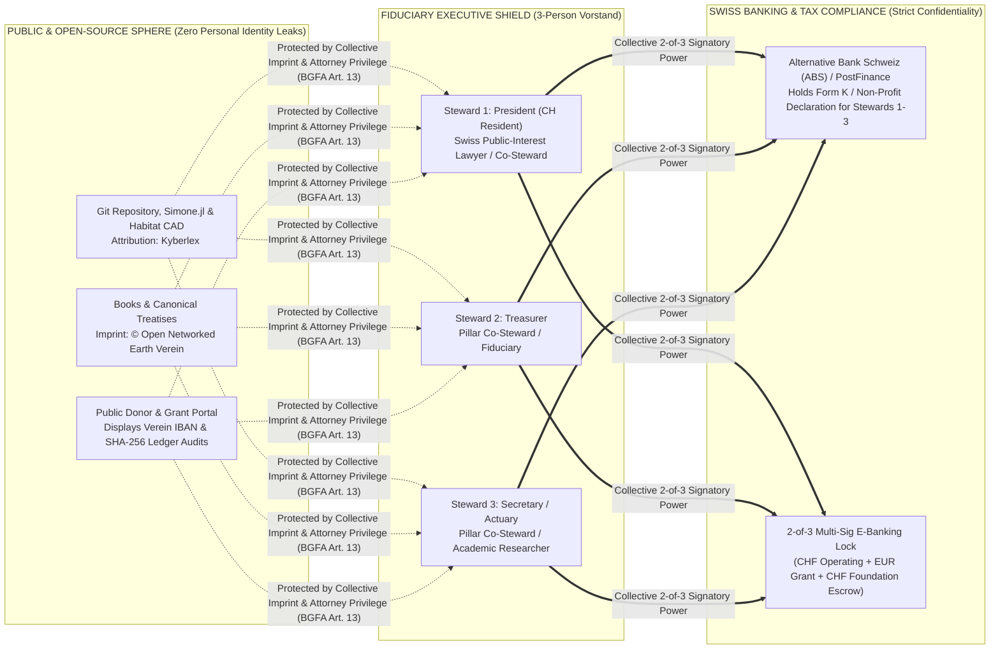

# **SWISS VEREIN BANKING, FORM K & CLASS-0 OPSEC DOSSIER**
## **Operational Playbook for Alternative Bank Schweiz (ABS), PostFinance & Multi-Sig Grant Custody**

**Document ID:** `foundation/verein_bootstrap/BANKING_ABS_AND_OPSEC_DOSSIER.md`  
**Author:** Kyberlex (`kyberlex@proton.me`)  
**Regulatory Framework:** Swiss Anti-Money Laundering Act (*Geldwäschereigesetz — GwG*), Agreement on the Swiss Banks' Code of Conduct with regard to the Exercise of Due Diligence (*Vereinbarung über die Standesregeln zur Sorgfaltspflicht der Banken — VSB 20 / CDB 20*, Arts. 26 & 37), Swiss Federal Act on Data Protection (*DSG*), Swiss Attorneys Act (*BGFA Art. 13*)  
**Companion Documents:** [`VEREIN_STATUTES_BILINGUAL_DE_EN.md`](VEREIN_STATUTES_BILINGUAL_DE_EN.md) | [`FOUNDING_ASSEMBLY_MINUTES_DE_EN.md`](FOUNDING_ASSEMBLY_MINUTES_DE_EN.md) | [`FIDUCIARY_TRUSTEE_MANDATE_TEMPLATE.md`](FIDUCIARY_TRUSTEE_MANDATE_TEMPLATE.md)

---

## **1. Executive Banking Strategy & Institution Selection Matrix**

Once **Open Networked Earth Verein (O.N.E. Verein)** has executed its Founding Minutes and Statutes (`CHF 0.-` capital), its immediate operational priority is to establish a clean, institutional Swiss IBAN architecture capable of:
1. Receiving international scientific and open-source grants (e.g., **NLnet Foundation / NGI Zero**, **Prototype Fund**, **Horizon Europe**, philanthropic foundations) in **EUR** and **CHF** without personal tax attribution or FX conversion losses;
2. Holding the growing **CHF 50,000+ Foundation ONE Escrow Reserve (`Stiftungs-Treuhandreserve`)** under a strict **2-of-3 Multi-Signature (*Doppelvisum*)** lock;
3. Preserving the **Class-0 OpSec Shield** for the architectural author (`Kyberlex <kyberlex@proton.me>`) and contributors in full compliance with Swiss banking due diligence (`CDB 20 / VSB 20`).

### **Swiss Banking Partner Comparison for Non-Profit Associations (*Vereine*)**

| Bank Institution | Account Type | Accepts Option A (Unregistered `ZGB Art. 60` Verein)? | Native Multi-Sig (*Doppelvisum 2-of-3*)? | Ethical & Non-Profit Alignment | Best Role in O.N.E. Architecture |
| :--- | :--- | :--- | :--- | :--- | :--- |
| **1. Alternative Bank Schweiz AG (ABS)** *(Olten)* | *Vereinskonto* (CHF & EUR) + *Sparkonto* (Escrow) | **Yes** (with signed *Statuten*, *Gründungsprotokoll*, and KYC of the 3 *Vorstand* signatories). | **Yes** (Native *Kollektivvisum zu zweien* via CrontoSign / PhotoTAN). | **Tier-1 Primary Choice:** Switzerland's flagship social/ecological bank; fossil-free, explicitly charters commons, land trusts, and non-profits; Seamless conversion of Sub-Account 3 into the *Kapitaleinzahlungskonto* for **Foundation ONE**. | **Primary Institutional Treasury, EUR Grant Account & Foundation ONE Escrow Vault.** |
| **2. PostFinance AG** *(Bern — Swiss Confederation)* | *Geschäftskonto Verein* (CHF & EUR) | **Yes** (expressly offers a streamlined onboarding track for non-registered Swiss *Vereine* under `ZGB Art. 60`). | **Yes** (PostFinance e-finance *Doppelvisum* / multiple authorizers). | High operational speed, state-backed payment infrastructure, lowest friction for unregistered Phase 0 *Vereine*. | **Rapid Day-1 Bootstrap IBAN** (or secondary payment rail alongside ABS). |
| **3. Cantonal Banks** *(ZKB Zürich / BEKB Bern / ZGKB Zug)* | *Vereinskonto / NGO-Konto* | **Yes** (for associations domiciled in the respective canton). | **Yes** (EBICS / e-banking collective release). | Explicit state guarantee (*Staatsgarantie* in ZKB/ZGKB), deep cantonal real-estate & *Baurecht* desk. | **Cantonal Escrow & Land / *Baurecht* Settlement Bank.** |
| **4. Sygnum Bank / AMINA Bank** *(Zug)* | Institutional Digital Asset & CHF Custody | Requires **Option B** (*Handelsregisterauszug*). | **Yes** (Institutional multi-sig cold custody). | FINMA-regulated Swiss crypto banks providing clean AML audit trails for BTC/ETH/USDC grant conversion into CHF. | **Stage 1B Optional Crypto Grant Off-Ramp** (only if receiving digital asset donations). |

---

## **2. Navigating *Form K* (`CDB 20 / VSB 20`) & The Class-0 OpSec Architecture**

A common misconception when setting up a Swiss legal entity is that the bank requires the disclosure of a private "Beneficial Owner of Assets" (*wirtschaftlich berechtigte Person an Vermögenswerten*, **Form A**) who owns the entity's money. **For a charitable, non-profit Swiss Verein or Stiftung, this is legally false.**

### **2.1. Why Non-Profit Associations Do Not File *Form A* (Beneficial Owner of Assets)**
- Under **Article 26 and Article 37 of the Agreement on the Swiss Banks' Code of Conduct with regard to the Exercise of Due Diligence (`VSB 20 / CDB 20`)** and the Swiss Anti-Money Laundering Act (`GwG Art. 4`), an **ideeller, gemeinnütziger Verein** (non-commercial, public-benefit association) holds **purpose-bound assets (*Zweckvermögen*)** with **no private beneficial owners**:
  - Under Article 3 and Article 12 of [`VEREIN_STATUTES_BILINGUAL_DE_EN.md`](VEREIN_STATUTES_BILINGUAL_DE_EN.md), no founder, board member, or donor has any claim to the income or principal of the Verein.
  - Because no natural person beneficially owns the assets, **CDB 20 explicitly exempts non-commercial/charitable associations and foundations from declaring a beneficial owner of assets on Form A.**

### **2.2. How *Form K* (Controlling Person / Executive Organ Declaration) Works for a Non-Profit *Verein***
Instead of Form A, Swiss banks onboarding an association apply the **Non-Profit / Charitable Entity Declaration** (either the bank's dedicated *Erklärung für ideelle Vereine und gemeinnützige Stiftungen* or the non-profit section of **Form K — Feststellung des Kontrollinhabers**):
1. **No Equity Control Threshold (`>= 25%`):** Because an ideal *Verein* has no capital shares and no owner holding 25% of voting equity, the first cascade of Form K is inapplicable.
2. **Identification of the Executive Organ (*Geschäftsführendes Organ / Vorstand*):** Under CDB 20 Art. 26 / Art. 37, the bank simply records the identity of the **natural persons serving on the executing Board (*Vorstand*) who hold signatory authority over the account** (the 3 Board Stewards elected in [`FOUNDING_ASSEMBLY_MINUTES_DE_EN.md`](FOUNDING_ASSEMBLY_MINUTES_DE_EN.md)).
3. **Standard KYC for the 3 *Vorstand* Members:** Each of the 3 elected Board Stewards (President, Treasurer, Secretary) completes standard video-ident or certified-ID verification (*Echtheitsbestätigung einer Ausweiskopie* at a Swiss post office / notary / SBB counter) so the bank can issue their individual e-banking hardware tokens.

### **2.3. How Class-0 OpSec Protects `Kyberlex <kyberlex@proton.me>` and Contributors**


This creates a **three-layer legal firewall** that is 100% compliant with Swiss AML/GwG law while enforcing absolute Class-0 OpSec:
1. **Layer 1 — Zero Public Registry Exposure under Option A (`ZGB Art. 60`):**
   By bootstrapping as an unregistered ideal *Verein* (Option A), neither the founding assembly minutes nor the Board members' names are published on the public internet (`zefix.ch`).
2. **Layer 2 — The 3-Steward Fiduciary *Vorstand* (`FIDUCIARY_TRUSTEE_MANDATE_TEMPLATE.md`):**
   The 3-member *Vorstand* consists of three vetted stewards (for example, a Swiss public-interest attorney / fiduciary as President + two Pillar Co-Stewards as Treasurer and Secretary). Because these three individuals genuinely exercise the collective 2-of-3 executive stewardship required by `ZGB Art. 69` and the Verein Statutes, they—and **only** they—are listed as the controlling executive officers on the bank's Form K / Non-Profit Declaration.
3. **Layer 3 — Swiss Attorney-Client Privilege (`BGFA Art. 13` & `StGB Art. 321`) for Architectural Counsel:**
   When a licensed Swiss attorney (*Rechtsanwalt / Rechtsanwältin*) is engaged to provide legal counsel or serve as the Swiss-resident domicile holder and board steward under [`FIDUCIARY_TRUSTEE_MANDATE_TEMPLATE.md`](FIDUCIARY_TRUSTEE_MANDATE_TEMPLATE.md), all legal and architectural consultations with `Kyberlex <kyberlex@proton.me>` concerning the drafting of statutes, copyright assignment, and constitutional governance constitute **classic legal representation (*typische Anwaltstätigkeit*)** protected by federal criminal-law secrecy (`StGB Art. 321` / `BGFA Art. 13`). Because `Kyberlex` holds zero beneficial ownership in the Verein's purpose-bound funds (*Zweckvermögen*) and exercises zero unilateral control over the bank account, there is no "strawman" (*Strohmann*) arrangement; the 3 *Vorstand* members are the true legal fiduciaries bound by the statutory asset lock.

---

## **3. Three-Sub-Account IBAN Architecture (CHF, EUR & Foundation Escrow)**

When submitting the account opening request to **Alternative Bank Schweiz (ABS)** or **PostFinance**, the *Vorstand* requests three segregated sub-accounts under the single customer relationship (*Stammnummer*) of **Open Networked Earth Verein**:

| Sub-Account Designation | Currency | Purpose & Cash-Flow Rules | Target Balance / Sweep Rule |
| :--- | :--- | :--- | :--- |
| **Account 1: `O.N.E. Verein — Betrieb & Spenden`** *(Operating & Donations Account)* | **CHF** (`CHxx ...`) | Receives CHF donations, Swiss foundation grants, and publication proceeds. Pays strictly verified administrative outlays (domain registration, cantonal registry fee if Option B is triggered, bank account maintenance). | Capped at a **CHF 2,500.–** operational buffer. Any balance exceeding CHF 2,500.– at quarter-end is automatically swept into **Account 3**. |
| **Account 2: `O.N.E. Verein — Forschungsbeiträge EUR`** *(EUR SEPA Grant Account)* | **EUR** (`CHxx ...`) | Dedicated EUR IBAN with full SEPA connectivity for receiving European open-source and scientific grants (**NLnet NGI Zero Commons/Core**, **Prototype Fund**, **Horizon Europe**) without forced FX spread upon receipt. | Milestone disbursements for open-source research deliverables are accounted per grant agreement; unencumbered surpluses are converted at interbank spot rate and swept into **Account 3**. |
| **Account 3: `Stiftungs-Treuhandreserve Foundation ONE`** *(Foundation Escrow Vault)* | **CHF** (`CHxx ...`) | **Irrevocably Purpose-Bound Escrow Sub-Account** pursuant to `Statutes Art. 3.3 & Art. 11`. Accumulates 100% of net surpluses and endowment donations toward the **CHF 50,000.–+** target required to incorporate **Stiftung Open Networked Earth (Foundation ONE)**. | Locked until **CHF 50,000.–** + Genesis Lock completion (`PRE_CLEARANCE_CHECKLIST_ESA.md`), at which point ABS converts or transfers the balance directly into the *Kapitaleinzahlungskonto* of **Foundation ONE**. |

---

## **4. Multi-Sig 2-of-3 E-Banking Authorization Rules (*Kollektivvisum zu zweien*)**

To ensure that no single Board member can ever move, freeze, or misdirect funds unilaterally, the bank mandate enforces the following technical and procedural controls:

1. **Mandatory Collective Dual Release (*Doppelvisum / Kollektivvisum zu zweien*):**
   - In the bank's signature card (*Unterschriftenkarte / Vollmachtsregelung*) and e-banking administration matrix, **Single Release (*Einzelvisum*) is set to CHF 0.00**.
   - Every outgoing payment, standing order modification, or internal transfer out of Account 3 (`Stiftungs-Treuhandreserve`) from **CHF 0.01 upward** requires:
     - **Initiation & First Hardware-Token Signature** (`CrontoSign` / `PhotoTAN`) by **Steward A** (typically the Treasurer / *Kassier*), AND
     - **Independent Second Hardware-Token Signature** by **Steward B** (the President or Secretary) from a separate device after verifying the invoice/grant milestone against the Verein's public ledger.
2. **Read-Only Audit Access (*Leseberechtigung*):**
   - All 3 *Vorstand* members hold 24/7 read-only access to real-time balances, PDF bank statements, and ISO 20022 (`camt.053`) XML transaction feeds across all three sub-accounts.
3. **Quarterly Cryptographic Transparency Proof:**
   - At the close of each calendar quarter, the Treasurer exports the official bank statements and `camt.053` XML files, redacts personal donor residential addresses in compliance with the Swiss Data Protection Act (*DSG*), computes the SHA-256 hash of the quarterly financial summary, and publishes the balance of the `Stiftungs-Treuhandreserve` in the repository's public transparency log.

---

## **5. Step-by-Step Bank Onboarding Checklist & Cover Letter Template**

### **5.1. Complete Onboarding Dossier Checklist**
Before mailing or uploading the application to **Alternative Bank Schweiz AG (ABS)** (Amthausquai 21, Postfach, 4601 Olten) or **PostFinance AG**:

- [ ] **1. Signed Articles of Association (*Vereinsstatuten*):** Original or certified copy of [`VEREIN_STATUTES_BILINGUAL_DE_EN.md`](VEREIN_STATUTES_BILINGUAL_DE_EN.md) signed by all 3 Founding Board members.
- [ ] **2. Signed Founding Assembly Minutes (*Gründungsprotokoll*):** Original or certified copy of [`FOUNDING_ASSEMBLY_MINUTES_DE_EN.md`](FOUNDING_ASSEMBLY_MINUTES_DE_EN.md) showing the election of the 3-member *Vorstand* with *Kollektivunterschrift zu zweien* and the bank account opening resolution (Agenda Item 7).
- [ ] **3. Certified ID Copies (*Echtheitsbestätigte Ausweiskopien*) of the 3 *Vorstand* Members:** Certified copy of the passport or national ID card for each of the 3 Board Stewards (obtainable at any Swiss Post branch — *"Gelbe Identifikation"* ~CHF 25, SBB counter, notary, or via the bank's online Video-Ident link).
- [ ] **4. Domicile Acceptance Declaration (*Domizilannahmeerklärung*):** Signed Annex A of [`FOUNDING_ASSEMBLY_MINUTES_DE_EN.md`](FOUNDING_ASSEMBLY_MINUTES_DE_EN.md) confirming the Swiss c/o address.
- [ ] **5. Completed Bank Application & *Form K* / Non-Profit Declaration:** Listing the 3 *Vorstand* members as the managing executive officers (*geschäftsführende Organpersonen*) and checking the box confirming that **Open Networked Earth Verein** is a non-commercial, public-benefit association (*ideeller / gemeinnütziger Verein*) with no private beneficial owners of assets.

---

### **5.2. Ready-to-Use Onboarding Cover Letter to Alternative Bank Schweiz (ABS)**

```text
================================================================================
GESUCH UM ERÖFFNUNG EINES VEREINSKONTOS (CHF / EUR / STIFTUNGS-TREUHANDRESERVE)
================================================================================
Absender:
Open Networked Earth Verein (O.N.E. Verein)
c/o [Name Domizilhalter/in, Strasse Nr., PLZ Zug / Zürich / Bern]
E-Mail: kyberlex@proton.me

An die
Alternative Bank Schweiz AG (ABS)
Kundendienst / Kontoeröffnung Institutionelle & Vereine
Amthausquai 21, Postfach
4601 Olten, Schweiz

Ort, Datum: [Zug / Zürich / Bern], [TT.MM.JJJJ]

Betrifft: Kontoeröffnung für den gemeinnützigen Verein «Open Networked Earth Verein»
          (ZGB Art. 60 ff.) mit Kollektivvisum zu zweien (2-von-3)

Sehr geehrte Damen und Herren,

im Namen des Vorstandes ersuchen wir Sie höflich um die Eröffnung einer Geschäftsbeziehung
für unseren neu gegründeten, rein gemeinnützigen Schweizer Verein:

   «Open Networked Earth Verein (O.N.E. Verein)» mit Sitz in [Zug / Zürich / Bern].

1. GEMEINNÜTZIGER ZWECK UND WERTEÜBEREINSTIMMUNG MIT DER ABS
   Der Verein verfolgt gemäss Art. 2 seiner Statuten ausschliesslich und unmittelbar
   gemeinnützige Zwecke in den Bereichen der quelloffenen wissenschaftlichen Forschung
   (biophysikalische Co-Simulation `Simone.jl`), der ökologischen Passivhaus-Holzbauarchitektur
   (`habitat/`) sowie der Vorbereitung spekulationsfreier Boden- und Allmende-Nutzniessungsmodelle.
   Sämtliche Forschungsergebnisse stehen der Allgemeinheit unentgeltlich unter freien
   Open-Source-Lizenzen (AGPL-3.0 / CERN-OHL / CC-BY-SA) zur Verfügung.

2. GEPLANTE KONTOSTRUKTUR (3 UNTERKONTEN)
   Für eine transparente Mittelverwaltung nach Swiss GAAP FER 21 bitten wir um Einrichtung
   folgender Konten unter unserer Stammnummer:
   - Konto 1 (Vereinskonto CHF) : Laufender Betrieb, Spenden & Schweizer Förderbeiträge;
   - Konto 2 (Vereinskonto EUR) : Empfang europäischer Open-Source-Forschungsbeiträge
                                  (insb. NLnet Foundation / NGI Zero, Prototype Fund);
   - Konto 3 (Sparkonto CHF)    : Zweckgebundene «Stiftungs-Treuhandreserve Foundation ONE»
                                  gemäss Art. 3 Abs. 3 und Art. 11 der Statuten zur Äufnung
                                  des Anfangskapitals (CHF 50'000.–) für die künftige
                                  gemeinnützige «Stiftung Open Networked Earth (Foundation ONE)».

3. ZEICHNUNGSBERECHTIGUNG UND E-BANKING (STRIKTES DOPPELVISUM 2-VON-3)
   Gemäss Art. 9 der Statuten und Traktandum 5 des Gründungsprotokolls zeichnen sämtliche
   drei Vorstandsmitglieder ausschliesslich kollektiv zu zweien. Wir bitten Sie, auch im
   ABS-E-Banking für sämtliche Konten ein zwingendes Doppelvisum (Freigabe durch 2 von 3
   Vorstandsmitgliedern ab CHF 0.01) einzurichten.

4. SORGFALTSPFLICHTEN (VSB 20 / FORMULAR K FÜR IDEELLE VEREINE)
   Als nicht-gewinnorientierter, gemeinnütziger Idealverein mit unwiderruflicher
   Vermögensbindung (Art. 3 und Art. 12 Statuten) existieren keine an den Vermögenswerten
   wirtschaftlich berechtigten Privatpersonen. Als geschäftsführende Organpersonen
   (Vorstand) fungieren die drei im Gründungsprotokoll aufgeführten Vorstandsmitglieder.

Beiliegend erhalten Sie:
  1. Unterzeichnete Vereinsstatuten vom [TT.MM.JJJJ];
  2. Unterzeichnetes Gründungsprotokoll vom [TT.MM.JJJJ];
  3. Domizilannahmeerklärung;
  4. Echtheitsbestätigte Ausweiskopien der 3 Vorstandsmitglieder.

Für die Zusendung der Kontoeröffnungsunterlagen und Ihre Unterstützung danken wir Ihnen
herzlich.

Mit freundlichen Grüssen,
Für den Vorstand des Open Networked Earth Verein (Kollektivunterschrift zu zweien):

____________________________________          ____________________________________
[Vorname Nachname Steward 1]                  [Vorname Nachname Steward 2]
Präsident/in des Vorstandes                   Kassier/in des Vorstandes
================================================================================
```
