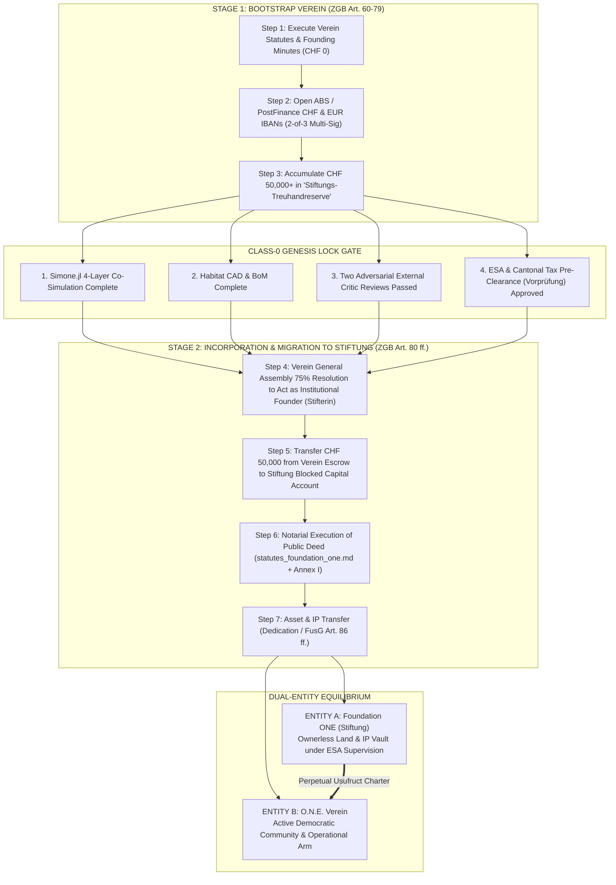

# **SWISS VEREIN BOOTSTRAP KIT (`foundation/verein_bootstrap/`)**
## **Zero-Capital Legal Inception, Banking & Statutory Migration Bridge to Foundation ONE**

**Document ID:** `foundation/verein_bootstrap/README.md`  
**Author:** Kyberlex (`kyberlex@proton.me`)  
**Jurisdiction:** Swiss Confederation (*Schweizerische Eidgenossenschaft*) — Swiss Civil Code (`ZGB Art. 60–79`), Swiss Code of Obligations (`OR`), Swiss Merger Act (`FusG Art. 86 ff.`)  
**Pillar Alignment:** Pillar 2 (Governance, Sortition & Swiss Corporate/Foundation Law)  
**Related Canonical Files:** [`foundation/README.md`](../README.md) | [`foundation/legal_framework.md`](../legal_framework.md) | [`foundation/statutes_foundation_one.md`](../statutes_foundation_one.md) | [`foundation/PRE_CLEARANCE_CHECKLIST_ESA.md`](../PRE_CLEARANCE_CHECKLIST_ESA.md)

---

## **1. Executive Architecture: Why Bootstrap via a Swiss *Verein*?**

Under the **Class-0 Prerequisite Gate** defined in [`foundation/PRE_CLEARANCE_CHECKLIST_ESA.md`](../PRE_CLEARANCE_CHECKLIST_ESA.md), the permanent ownerless vault—**Stiftung Open Networked Earth (Foundation ONE)** (`ZGB Art. 80 ff.`)—requires:
1. **CHF 50,000** in liquid initial endowment capital (*Anfangsvermögen*), and
2. Completion of the **Genesis Lock** (full verification of `Simone.jl`, `habitat/` engineering blueprints, and two rounds of independent External Critic audits across Pillars 1–4).

However, **Open Networked Earth (O.N.E.)** requires an immediate, sovereign, zero-capital legal person **today (Phase 0)** to:
- Apply for and receive institutional open-source and scientific grants (e.g., **NLnet NGI Zero**, **Prototype Fund**, **Horizon Europe**, philanthropic donations) without routing funds through any individual's personal bank account;
- Open an institutional Swiss multi-signature bank account (CHF and EUR SEPA IBANs) at **Alternative Bank Schweiz (ABS)**, **PostFinance**, or a **Cantonal Bank**;
- Hold domain names, collective publishing imprints (`© Open Networked Earth Verein`), and fiduciary land-option agreements;
- Enforce an **Irrevocable Statutory Asset Lock (*Unwiderrufliche Vermögensbindung*)** guaranteeing donors and grantmakers that 100% of accumulated reserves are legally bound to endow **Foundation ONE** upon completion of the Genesis Lock;
- Protect the architectural founder (`Kyberlex <kyberlex@proton.me>`) and contributors under a strict **Class-0 OpSec and Fiduciary Board Shield**.

Article 60, Paragraph 1 of the Swiss Civil Code (*Schweizerisches Zivilgesetzbuch — ZGB*) provides the cleanest legal instrument on Earth for this purpose:
> *"Associations with a political, religious, scientific, artistic, charitable, social or other non-commercial purpose acquire legal personality as soon as their will to exist as a corporate body is apparent from their articles of association."* (`ZGB Art. 60 Abs. 1`)

---

## **2. Contents of the Swiss Verein Bootstrap Kit**

| File | Document Title | Operational Purpose |
| :--- | :--- | :--- |
| [`README.md`](README.md) | **Executive Architecture & Migration Roadmap** | Decision matrix (Option A Unregistered vs. Option B Commercial Register Inscribed) and step-by-step migration mechanics from *Verein* to *Stiftung* (`Foundation ONE`). |
| [`VEREIN_STATUTES_BILINGUAL_DE_EN.md`](VEREIN_STATUTES_BILINGUAL_DE_EN.md) | **Bilingual Articles of Association (*Vereinsstatuten*)** | Standalone, execution-ready German (authoritative) and English (canonical) Statutes for **"Open Networked Earth Verein (O.N.E. Verein)"**, embedding the `Foundation ONE` escrow asset lock, 3-member odd-parity *Vorstand*, 75% supermajority rule, and `ZGB Art. 75a` zero personal liability shield. |
| [`FOUNDING_ASSEMBLY_MINUTES_DE_EN.md`](FOUNDING_ASSEMBLY_MINUTES_DE_EN.md) | **Bilingual Founding Assembly Minutes (*Gründungsprotokoll*)** | Ready-to-sign constitutive minutes for the 3 initial board stewards, including agenda, unanimous adoption of statutes, election of the 3-member *Vorstand*, statutory auditor waiver (*Opting-out*, `ZGB Art. 69b`), domicile acceptance annex, and signatory blocks. |
| [`BANKING_ABS_AND_OPSEC_DOSSIER.md`](BANKING_ABS_AND_OPSEC_DOSSIER.md) | **Banking (ABS / PostFinance) & Class-0 OpSec Playbook** | Operational guide for opening CHF/EUR IBANs and the Foundation Escrow sub-account, navigating `CDB 20 / VSB 20` *Form K* (beneficial ownership exception for charitable associations), preserving founder pseudonymity, and enforcing 2-of-3 multi-sig e-banking authorization. |
| [`FIDUCIARY_TRUSTEE_MANDATE_TEMPLATE.md`](FIDUCIARY_TRUSTEE_MANDATE_TEMPLATE.md) | **Fiduciary & Co-Steward Board Mandate (*Treuhand- und Vorstandsauftrag*)** | Bilingual legal agreement (`OR Art. 394 ff.`) and NDA for engaging a Swiss public-interest lawyer, licensed fiduciary, or Pillar 1–4 Co-Steward to serve pro bono (*ehrenamtlich*) on the initial 3-person *Vorstand* without violating Class-0 constraints. |

---

## **3. Decision Matrix: Option A (Unregistered Ideal Verein) vs. Option B (Inscribed Verein)**

Under Swiss law (`ZGB Art. 60–61`), a non-commercial association (*ideeller Verein*) acquires full legal personality **immediately upon signing the Founding Minutes and Statutes**, without requiring a notary, state approval, or Commercial Register entry. However, the *Verein* may voluntarily inscribe itself in the Cantonal Commercial Register (*Handelsregister*) at any time under `ZGB Art. 61 Abs. 1`.

| Dimension | **Option A: Unregistered Ideal Verein (`ZGB Art. 60`)** | **Option B: Commercial-Register Inscribed Verein (`ZGB Art. 61`)** |
| :--- | :--- | :--- |
| **Legal Basis** | `ZGB Art. 60 Abs. 1` (Constitutive by private written act). | `ZGB Art. 61 Abs. 1` & `HRegV Art. 90` (Voluntary inscription of a non-commercial Verein). |
| **Minimum Capital** | **CHF 0.-** | **CHF 0.-** |
| **Notary / Registry Fees** | **CHF 0.-** (Zero state or notarial cost). | **~CHF 400 to CHF 600** (Cantonal Commercial Register fee + CHF 30–50 per signature certification). |
| **Time to Legal Personality** | **Instant (Day 1)** — immediately upon signing [`FOUNDING_ASSEMBLY_MINUTES_DE_EN.md`](FOUNDING_ASSEMBLY_MINUTES_DE_EN.md) and [`VEREIN_STATUTES_BILINGUAL_DE_EN.md`](VEREIN_STATUTES_BILINGUAL_DE_EN.md). | **2 to 4 weeks** (Legal personality exists on Day 1 under Option A; public *Handelsregisterauszug* issues 10–20 business days after filing). |
| **Public Registry Exposure (*Zefix*)** | **Zero Public Exposure** — Neither the Founders nor the 3 *Vorstand* members appear on the public federal Zefix database. Board identities are disclosed strictly to the Swiss bank under banking secrecy (`CDB 20 Form K`) and to tax/grant authorities upon request. | **Public Extract (*Handelsregisterauszug*)** — The Verein's name, seat, purpose, and the names/citizenships/municipalities of residence of the authorized *Vorstand* signatories are published on `zefix.ch`. (Founding members who are not on the *Vorstand* remain private if a clean excerpt is filed). |
| **UID Number (*Unternehmens-ID*)** | Assigned upon request via the Cantonal Tax Administration (when applying for tax exemption) or Federal Statistical Office (BFS), though without a `CHE-... HR` suffix. | Automatically assigned a public `CHE-XXX.XXX.XXX` UID with Commercial Register extract upon entry. |
| **Swiss Bank Account Opening** | **Supported** at **Alternative Bank Schweiz (ABS)**, **PostFinance** (*Vereinskonto*), and most Cantonal Banks by submitting the signed *Statuten* and *Gründungsprotokoll*. | **Universally Supported** across all Swiss banks, international wire desks, and regulated crypto-to-fiat institutions (Sygnum / AMINA). |
| **Grant & Institutional Eligibility** | Sufficient for **NLnet NGI Zero**, **Prototype Fund**, private philanthropic grants, and micro-donations. | Required for large **EU Horizon Europe** consortium coordinator roles, notarial real estate / *Baurecht* deeds, and statutory Merger Act transfers (`FusG Art. 86 ff.`). |
| **Statutory Audit (*Revisionspflicht*)** | **Exempt (*Opting-out*)** unless exceeding two of three major thresholds (`ZGB Art. 69b Abs. 1`: CHF 10M balance sheet / CHF 20M revenue / 50 FTE). | **Exempt (*Opting-out*)** under the exact same `ZGB Art. 69b` rules. |
| **Personal Liability Shield** | **100% Shielded (`ZGB Art. 75a`)** — Liability strictly limited to Verein assets (`Art. 4 & 5` of Statutes fix membership dues at CHF 0.-). | **100% Shielded (`ZGB Art. 75a`)** — Identical statutory liability shield. |

### **Recommended Two-Step Operational Trajectory (Option A $\to$ Option B $\to$ Foundation ONE)**
1. **Day 1 (Immediate Bootstrap — Option A):** Execute [`FOUNDING_ASSEMBLY_MINUTES_DE_EN.md`](FOUNDING_ASSEMBLY_MINUTES_DE_EN.md) and [`VEREIN_STATUTES_BILINGUAL_DE_EN.md`](VEREIN_STATUTES_BILINGUAL_DE_EN.md) as an **Unregistered Ideal Verein (`ZGB Art. 60`)** for **CHF 0.-**. Open the association IBAN at **Alternative Bank Schweiz (ABS)** or **PostFinance** using [`BANKING_ABS_AND_OPSEC_DOSSIER.md`](BANKING_ABS_AND_OPSEC_DOSSIER.md), file for cantonal tax exemption (*Steuerbefreiung gemäss DBG Art. 56 lit. g*), and begin receiving Phase 0 open-source research grants.
2. **Pre-Endowment Upgrade (Option B — When Needed):** Prior to executing real estate options, large EU institutional grants, or a Merger Act (`FusG Art. 86 ff.`) transfer, file the voluntary Commercial Register application (`ZGB Art. 61 Abs. 1`) using the template in Section 4 of [`FOUNDING_ASSEMBLY_MINUTES_DE_EN.md`](FOUNDING_ASSEMBLY_MINUTES_DE_EN.md). The Verein's legal identity, tax ruling, and IBAN remain 100% unchanged.

---

## **4. Step-by-Step Migration Mechanics: From *O.N.E. Verein* to *Foundation ONE (Stiftung O.N.E.)***

Article 3.3 and Article 11 of [`VEREIN_STATUTES_BILINGUAL_DE_EN.md`](VEREIN_STATUTES_BILINGUAL_DE_EN.md) hard-code a self-executing fiduciary bridge from the bootstrap *Verein* into **Stiftung Open Networked Earth (Foundation ONE)** ([`foundation/statutes_foundation_one.md`](../statutes_foundation_one.md)).

### **Detailed 5-Phase Legal Execution Sequence**

#### **Phase 1: Escrow Accumulation & ESA Pre-Clearance (*Vorprüfung*)**
- As grants (NLnet, Prototype Fund) and philanthropic contributions arrive in the Verein's bank account, all surpluses above approved minimal administrative outlays (domain, registry, audit) are swept into **Sub-Account 3 (`Stiftungs-Treuhandreserve`)**.
- Under Article 3.3 of the Verein Statutes, this reserve is subject to an **Irrevocable Purpose-Bound Asset Lock (*Unwiderrufliche Vermögensbindung*)**: neither the *Vorstand* nor the General Assembly can divert these funds to private individuals or commercial ventures.
- Once the reserve approaches **CHF 50,000** and the technical Genesis Lock gates ([`foundation/PRE_CLEARANCE_CHECKLIST_ESA.md`](../PRE_CLEARANCE_CHECKLIST_ESA.md)) are met, the Verein's *Vorstand* submits Part B of [`foundation/statutes_foundation_one.md`](../statutes_foundation_one.md) to the **Federal Foundation Supervisory Authority (*Eidgenössische Stiftungsaufsicht — ESA*, Bern)** and the **Cantonal Tax Administration** for binding pre-examination (*Vorprüfung*).

#### **Phase 2: General Assembly Founder Mandate (*Stiftungsbeschluss der Vereinsversammlung*)**
- Upon receiving positive *Vorprüfung* confirmation from the ESA and the Cantonal Tax Administration, the Verein convenes an extraordinary General Assembly under Article 7 and Article 11 of [`VEREIN_STATUTES_BILINGUAL_DE_EN.md`](VEREIN_STATUTES_BILINGUAL_DE_EN.md).
- By a **75% qualified supermajority vote**, the General Assembly resolves that:
  1. **Open Networked Earth Verein (O.N.E. Verein)** shall act as the institutional **Founder (*Stifterin*)** of **Stiftung Open Networked Earth (Foundation ONE)** (`ZGB Art. 80 ff.`);
  2. **CHF 50,000.-** (plus any designated surplus endowment) from the *Stiftungs-Treuhandreserve* is released to a blocked Foundation Capital Contribution Account (*Kapitaleinzahlungskonto*) in the name of *Stiftung Open Networked Earth (in Gründung)*;
  3. Two authorized members of the *Vorstand* (exercising *Kollektivunterschrift zu zweien*) are empowered to appear before a licensed Swiss Notary (or issue a notarized power of attorney) to execute the Public Deed (*Öffentliche Stiftungsurkunde*).

#### **Phase 3: Notarial Execution & Genesis Lock Deposit (`ZGB Art. 80 & 81`)**
- Appearing as the institutional Founder (*Stifterin*), **O.N.E. Verein** executes the Public Deed codified in Part B of [`foundation/statutes_foundation_one.md`](../statutes_foundation_one.md).
- Simultaneously, the finalized, SHA-256 hash-locked Living Constitution ([`ONE NETWORKED EARTH (O.N.E.).md`](../../ONE%20NETWORKED%20EARTH%20%28O.N.E.%29.md)) is notarially deposited as **Statutory Annex I (*Statutarischer Verfassungsanhang I*)** pursuant to Article 13.4 of the Foundation Statutes, activating **Rigid Canonical Immutability**.
- Note on Founder Privacy: Because **O.N.E. Verein** acts as the legal *Stifterin* (Corporate Founder), no individual human founder's personal name needs to be inscribed as a private financial benefactor in the Foundation Deed.

#### **Phase 4: Legal Transfer of Remaining Assets, Contracts & IP Imprints**
Depending on whether the Verein operated under **Option A** or **Option B** prior to the transition, Swiss law provides two clean transfer tracks:
- **Track 4A — Direct Endowment & Specific Assignment (If the Verein remained under Option A Unregistered):**
  - Directly within the notarial Foundation Deed (*Stiftungsurkunde*) and an accompanying written **Endowment & IP Assignment Agreement (*Widmungs- und Abtretungsvertrag*, `OR Art. 164 ff.`)**, the Verein assigns its cash endowment, domain names, copyright/copyleft stewardship imprints, and grant deliverables directly to **Foundation ONE** upon its Commercial Register inscription.
- **Track 4B — Universal Succession via the Swiss Merger Act (If the Verein inscribed under Option B or holds real estate / complex contracts):**
  - If both the *Verein* and the newly incorporated *Stiftung* are inscribed in the Commercial Register, they execute a **Statutory Asset Transfer Agreement (*Vermögensübertragungsvertrag* pursuant to `FusG Art. 86–88`)** accompanied by an audited inventory of assets and liabilities.
  - Upon registration of the *Vermögensübertragung* in the Commercial Register (`FusG Art. 87 Abs. 2`), all listed assets, land options, *Baurechte*, and contracts transfer **ipso jure (automatically by operation of law in a single act)** to **Foundation ONE**.

#### **Phase 5: Post-Migration Dual-Tier Equilibrium (Retaining the Verein as Entity B)**
- **Crucial Architectural Principle:** Upon founding **Foundation ONE**, **O.N.E. Verein is NOT dissolved**.
- Instead, the system enters the permanent **Two-Tier Shield Architecture** defined in [`foundation/legal_framework.md`](../legal_framework.md) and [`foundation/statutes_foundation_one.md`](../statutes_foundation_one.md) (Part C, Section 1):
  - **Entity A — Stiftung Open Networked Earth (Foundation ONE):** The ownerless, takeover-proof passive vault supervised by the Federal Foundation Supervisory Authority (*ESA*), holding all land titles, endowment reserves, and canonical IP in perpetuity.
  - **Entity B — Open Networked Earth Verein (O.N.E. Verein):** The active democratic membership association, organizing contributors, administering sortition panels (including the emergency anti-curator reconstitution mandate under `Statutes Foundation ONE Art. 5.6` / `ZGB Art. 83d`), and operating day-to-day programs under revocable usufruct charters.

---

## **5. Quick-Start Execution Checklist (Today — Phase 0)**

- [ ] **1. Select the 3 Initial Honorary Board Stewards (*Vorstand*):** Identify 3 natural persons (e.g., Pillar Co-Stewards or a Swiss public-interest lawyer/fiduciary + 2 Co-Stewards) to serve as President, Treasurer, and Secretary/Actuary.
- [ ] **2. Execute Fiduciary / Co-Steward Mandate Agreements:** Sign [`FIDUCIARY_TRUSTEE_MANDATE_TEMPLATE.md`](FIDUCIARY_TRUSTEE_MANDATE_TEMPLATE.md) with each of the 3 *Vorstand* members to lock in pro bono (*ehrenamtlich*) status, 2-of-3 signature discipline, and Class-0 OpSec.
- [ ] **3. Convene the Founding Assembly (Remote or Physical):** Complete and sign [`VEREIN_STATUTES_BILINGUAL_DE_EN.md`](VEREIN_STATUTES_BILINGUAL_DE_EN.md) and [`FOUNDING_ASSEMBLY_MINUTES_DE_EN.md`](FOUNDING_ASSEMBLY_MINUTES_DE_EN.md). *(Cost: CHF 0.-; Time: 30 minutes)*.
- [ ] **4. Open the Verein Bank Accounts (ABS or PostFinance):** Submit the onboarding packet prepared in [`BANKING_ABS_AND_OPSEC_DOSSIER.md`](BANKING_ABS_AND_OPSEC_DOSSIER.md) to open the CHF Operating Account, EUR SEPA Grant Account, and CHF *Stiftungs-Treuhandreserve* Escrow Account with 2-of-3 multi-sig e-banking.
- [ ] **5. File for Cantonal Tax Exemption (*Steuerbefreiung*):** Submit the signed *Vereinsstatuten* and *Gründungsprotokoll* to the Cantonal Tax Administration (*Kantonale Steuerverwaltung*) requesting recognition of tax exemption for charitable/scientific public-benefit purposes under `DBG Art. 56 lit. g`.
